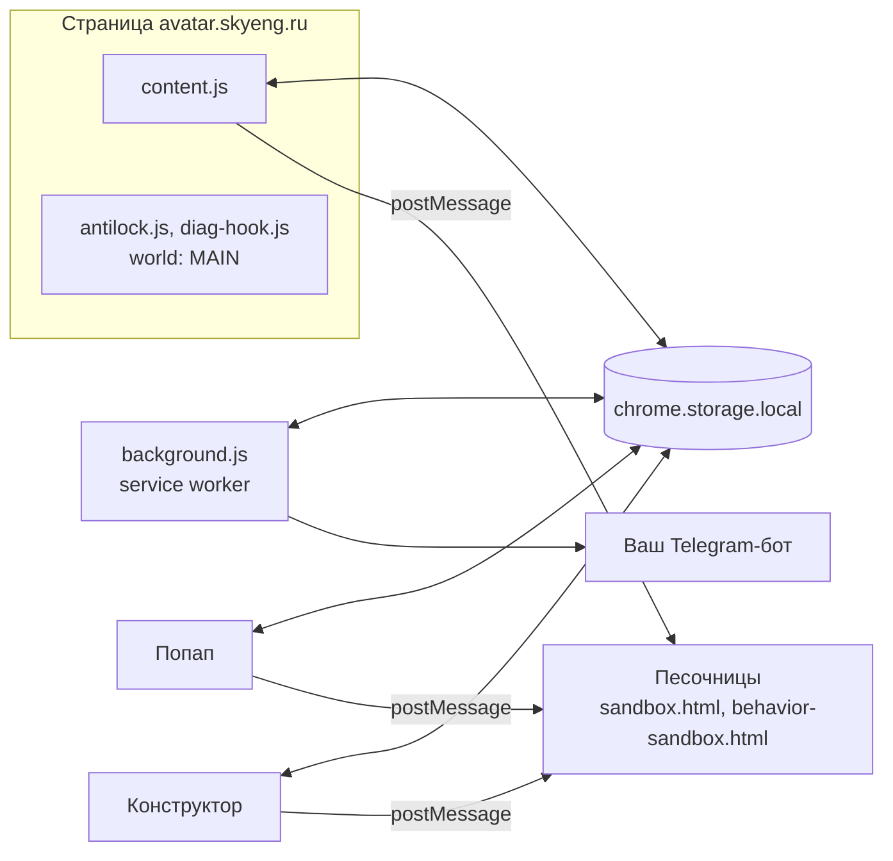

<div align="center">

# SkyMod

**Кастомизация интерфейса [avatar.skyeng.ru](https://avatar.skyeng.ru):<br>цвета, шрифты, фон, расписание и собственный canvas-код прямо на странице сайта.**

<br>


[](https://developer.chrome.com/docs/extensions/mv3/)
[](CHANGELOG.md)
[](LICENSE)
[](#разработка)
[](#разработка)
[](#установка)

[Установка](#установка) ·
[Возможности](#возможности) ·
[Скриншоты](#скриншоты) ·
[Как это работает](#как-это-работает) ·
[Roadmap](#roadmap) ·
[Вклад](#вклад)

<br>


</div>

<br>

> [!NOTE]
> SkyMod — неофициальное расширение. Оно не связано со Skyeng, Skypro и Sky Group и не одобрено ими.

## Что это

SkyMod меняет внешний вид личного кабинета Skyeng / Skypro и добавляет несколько удобств поверх стандартного интерфейса. Всё работает локально в вашем браузере: данные никуда не отправляются. Единственное исключение — ваш собственный Telegram-бот, если вы подключите его для напоминаний.

Расширение не заменяет функции сайта, а дополняет их. Настройки лежат в `chrome.storage.local`, применяются на лету и не требуют перезагрузки страницы.

| Без сборки | Всё локально | Полностью настраиваемо |
| :--- | :--- | :--- |
| Ванильный JS, ноль зависимостей. Работает прямо из папки. | Настройки в браузере, трекеры заблокированы, ничего не уходит на сторонние серверы. | От цвета карточки до собственного canvas-фона на весь экран. |

## Возможности

### Вид

| Функция | Что делает |
| :--- | :--- |
| Фон страницы | Сплошной цвет, градиент, анимированный RGB-перелив, свой CSS или картинка/gif (ссылка или файл) |
| Шрифт | Готовые пресеты, ссылка на Google Fonts или свой файл. Библиотека хранит все загруженные шрифты сразу |
| Карточки занятий | Цвет, прозрачность, читаемость на цветном фоне, свой цвет для каждого предмета |

### Расписание

| Функция | Что делает |
| :--- | :--- |
| Свои блоки | Своё событие на сетке (репетитор, секция, работа) с цветом, временем и повтором |
| Цвета предметов | Автоматический подбор или ручной выбор для каждого предмета |
| Свечение под текущий урок | Фон подсвечивается цветом идущего занятия |
| Полоска «сейчас» | Тонкая настройка цвета и вида маркера текущего времени |
| Окно занятия | Размытие и затемнение фона, свой цвет панели |

### Удобство

| Функция | Что делает |
| :--- | :--- |
| Внешние ссылки | Открываются в новой вкладке, сайт не закрывается |
| Блокировка трекеров | Google Analytics и Tag Manager отключаются через `declarativeNetRequest` |
| Скрытие элементов | Кнопка поддержки, аватарка, заголовок, меню, значок в шапке |
| Защита от блокировки | Сайт не перезагружает страницу при долгом отсутствии |
| Диагностика | Журнал запросов, событий и слушателей страницы для разбора багов. Только локально |

### Задания и Telegram

| Функция | Что делает |
| :--- | :--- |
| Кнопка «Следующее задание» | Переход к следующей задаче без возврата к списку. Перетаскивается, помнит позицию, горячая клавиша `Alt+N` |
| Напоминания в Telegram | Через вашего собственного бота: свой токен, свой чат, без общего сервера. Отдельные переключатели для занятий, контрольных и своих блоков |

### Конструктор

Отдельная полноценная страница (не тесный попап) с редактором кода, отладчиком, консолью, пресетами и живым предпросмотром.

| Режим | Что можно сделать |
| :--- | :--- |
| Песочница попапа | Свой HTML/CSS/JS в окне расширения, поверх или под интерфейсом |
| Фон сайта | Свой canvas/JS на весь экран avatar.skyeng.ru, работает, пока открыта вкладка |
| Части интерфейса | Свой CSS для отдельных элементов сайта. В комплекте готовый промпт для ИИ: скопировали, вставили в чат, получили рабочий CSS |
| Поведение карточек | HTML-шаблон и JS-логика для карточек занятий и своих блоков |
| Глобальный CSS попапа | Переопределение любого стиля самого расширения |

### Попап

- **Три размера:** компактный, крупный, максимальный (в пределах лимитов Chrome).
- **Свои цвета** отдельно для «Mod» в шапке, для пульсов и для остального интерфейса.
- **Дорожки платы** на canvas с анимированными импульсами.
- **Экспорт и импорт** всех настроек одним файлом, с выбором категорий при импорте.

## Скриншоты

<table>
  <tr>
    <td align="center" width="50%">
      <br>
      <sub>Попап, вкладка «Вид»</sub>
    </td>
    <td align="center" width="50%">
      <br>
      <sub>Конструктор, режим «Сайт»</sub>
    </td>
  </tr>
  <tr>
    <td align="center" width="50%">
      <br>
      <sub>Расписание, свои блоки</sub>
    </td>
    <td align="center" width="50%">
      <br>
      <sub>Фон сайта, canvas-анимация</sub>
    </td>
  </tr>
</table>

## Установка

Расширение не опубликовано в Chrome Web Store, поэтому ставится из исходников в режиме разработчика.

1. Скачайте или склонируйте репозиторий:

   ```bash
   git clone https://github.com/sploofer1/SkyMod.git
   ```

2. Откройте `chrome://extensions/`.
3. Включите **Режим разработчика** в правом верхнем углу.
4. Нажмите **Загрузить распакованное** и выберите папку с `manifest.json`.
5. Откройте [avatar.skyeng.ru](https://avatar.skyeng.ru) и кликните на иконку расширения.

> [!TIP]
> После установки всё уже работает с разумными настройками по умолчанию: включены блокировка трекеров, защита от блокировки сайта и кнопка «Следующее задание». Остальное настраивается по желанию.

**Поддерживаемые браузеры:** Chrome 120+, Edge, Brave, Arc и любой другой Chromium-браузер с поддержкой Manifest V3.

## Как это работает

Сайт построен на CSS-переменных (`--ds-color-*` и `--ds-color2-color-*`). Вместо того чтобы точечно красить сотни элементов, расширение переопределяет несколько переменных в одном теге `<style>`, а браузер сам применяет новый цвет везде, где они используются.



- **Цвета.** Через `document.documentElement.style.setProperty(..., 'important')`, максимальный приоритет в CSS.
- **Фон страницы.** Прямой `!important` на обёртки (`.page-scroll`, `.dashboard-shell`, `.topbar`): они красят себя хардкодом, а не через переменные.
- **Пользовательский код.** Выполняется в отдельных sandbox-страницах без доступа к `chrome.*` и DOM попапа. Связь с ними только через `postMessage`.
- **Расписание.** Расширение читает карточки занятий прямо со страницы, сохраняет их в `chrome.storage.local` и раз в 15 секунд пересчитывает, что идёт сейчас. Данные доступны и попапу, и коду фона.
- **Производительность.** Для применения темы в `content.js` нет ни одного `setInterval` и ни одного `MutationObserver`: при загрузке страницы читаются настройки и собирается один тег `<style>`.

<details>
<summary><b>Структура проекта</b></summary>

<br>

```text
SkyMod/
├── manifest.json            Манифест MV3
├── background.js            Service worker: трекеры, SPA-навигация, Telegram
├── content.js               Главный content script: тема, расписание, фон сайта
├── schedule-core.js         Общая логика расписания (используется в трёх местах)
├── part-runtime.js          Общие утилиты для частей интерфейса
├── antilock.js              Защита от «страница заскучала» (world: MAIN)
├── diag-hook.js             Диагностический хук (world: MAIN)
│
├── rules/
│   └── trackers.json        Правила declarativeNetRequest
│
├── math/                    Модуль «Следующее задание»
│   ├── list-page.js
│   ├── task-page.js
│   └── style.css
│
├── popup/
│   ├── popup.html/.js/.css          Основной попап
│   ├── popup-size-early.js          Ставит размер попапа до первой отрисовки
│   ├── builder.html/.js/.css        Страница конструктора
│   ├── builder-tour.js              Обучающий тур по конструктору
│   ├── parts.js                     Реестр частей интерфейса и генераторы промптов
│   ├── part-preview.js              Живой предпросмотр частей
│   ├── docs.html/.js                Документация конструктора
│   ├── backup.html/.js              Страница бэкапа настроек
│   ├── settings-io.js               Общий экспорт и импорт
│   ├── sandbox.html/.js             Песочница пользовательского кода
│   └── behavior-sandbox.html/.js    Песочница поведения карточек
│
└── docs/screenshots/        Скриншоты для README
```

</details>

## Разработка

Сборки нет. Совсем: правьте файлы прямо в папке расширения.

| Что делаем | Как |
| :--- | :--- |
| Применить изменения | На `chrome://extensions/` нажмите **Обновить** на карточке SkyMod, затем обновите вкладку сайта (`F5`). Service worker перезапускается сам |
| Отладить content script | `F12` на странице сайта, **Sources**, **Content scripts**, SkyMod |
| Отладить попап | Правый клик на иконке, **Просмотреть код попапа** |
| Отладить конструктор | `F12` на открытой странице `builder.html` |

**Стиль кода**

- ES2020 без транспиляции, никаких бандлеров и внешних зависимостей.
- `const` / `let`, `async` / `await`, шаблонные строки там, где уместно.
- Комментарии на русском, по делу.

## Roadmap

Полный список в [TODO.md](TODO.md), история изменений в [CHANGELOG.md](CHANGELOG.md). Коротко:

| Приоритет | Задача |
| :---: | :--- |
| **P0** | Глобальный рефакторинг конструктора: пресеты, предпросмотр попапа, общий UX, мелкие баги |
| **P0** | Прогресс при загрузке файлов |
| **P1** | Фон сайта получает координаты карточек: свечение и следы по краям карточки при наведении |
| **P1** | Кросс-песочное взаимодействие через `api.bus`: события между фоном и поведением карточек |
| **P1** | Больше частей интерфейса в реестре и мелкие улучшения диагностики и экспорта |
| **P2** | Экспорт и импорт тем, галерея готовых тем, режим «Фокус», кастомные звуки |

<details>
<summary><b>Недавно сделано</b></summary>

<br>

- **2.19.3** — единое правило «часть владеет настройками», замки в попапе обновляются сразу.
- **2.19.2** — исправлена часть «Карточка занятия»: настройки попапа больше не перебивают CSS части.
- **2.19.1** — адаптация под обновление сайта от 08.10.2026: новая разметка карточки, маркер `.now-marker`.
- **2.18.0** — живой предпросмотр частей интерфейса в конструкторе.
- **2.17.0** — поведение карточек: свои HTML и JS.

</details>

## Вклад

Issues и pull request'ы приветствуются.

- **Баг.** Заведите issue с шагами воспроизведения и, если возможно, приложите диагностический снимок: Попап, Удобство, Диагностика, Скачать снимок.
- **Идея.** Опишите сценарий: «сейчас делаю X, хочу Y, потому что Z». Без сценария сложно оценить пользу.
- **Pull request.** Сначала обсудите в issue. Небольшие точечные правки принимаются быстрее крупных рефакторингов.

> [!WARNING]
> Нельзя добавлять внешние зависимости и сборку, подключать сторонние CDN, шрифты и иконки сверх уже используемых, отправлять пользовательские данные на сторонние серверы, а также ломать существующие ключи в `chrome.storage.local` (только миграция).

## Лицензия

[MIT](LICENSE). Делайте что хотите, только сохраните копирайт.

## Автор

**sploofer1** — [github.com/sploofer1](https://github.com/sploofer1)

## Отказ от ответственности

SkyMod — неофициальное расширение. Оно не связано со Skyeng, Skypro и Sky Group, не одобрено и не поддерживается ими.

Расширение не затрагивает оценки, дедлайны и содержимое курсов. Все настройки хранятся локально в вашем браузере. Если вы подключаете Telegram-уведомления, они идут через вашего собственного бота, а токен хранится локально и никому не передаётся.

Если сайт обновится и что-то сломается, напишите issue и приложите диагностический снимок.

<br>

<div align="center">

**Сделано для тех, кто каждый день открывает Skyeng.**

Если зашло, поставьте звезду репозиторию.

</div>
