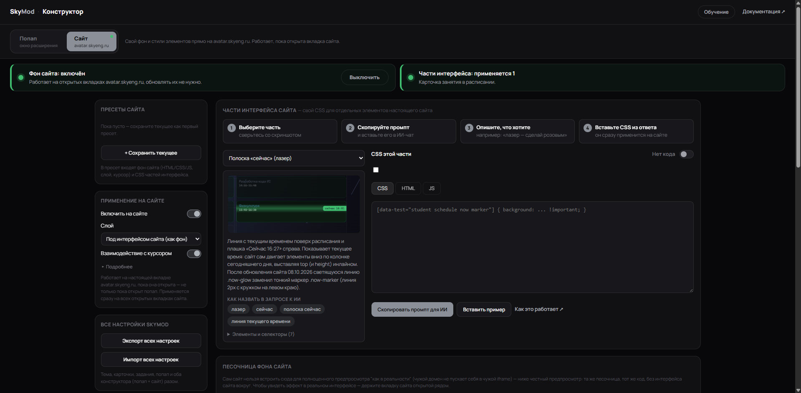
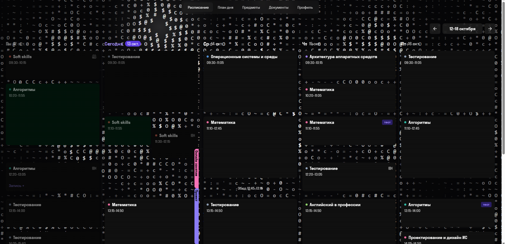
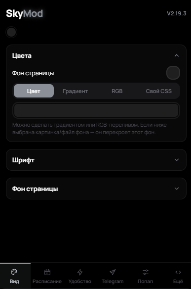
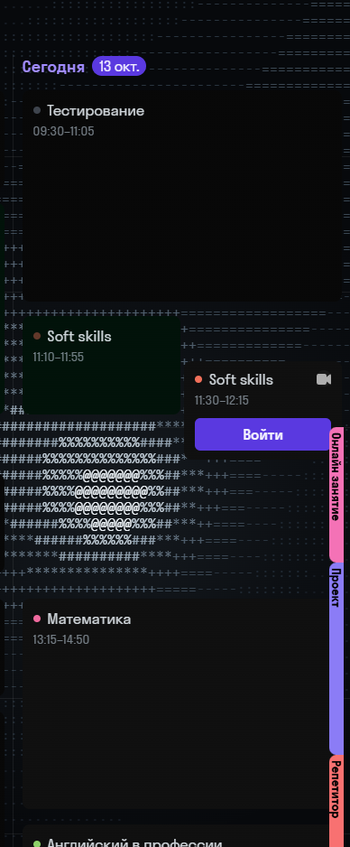
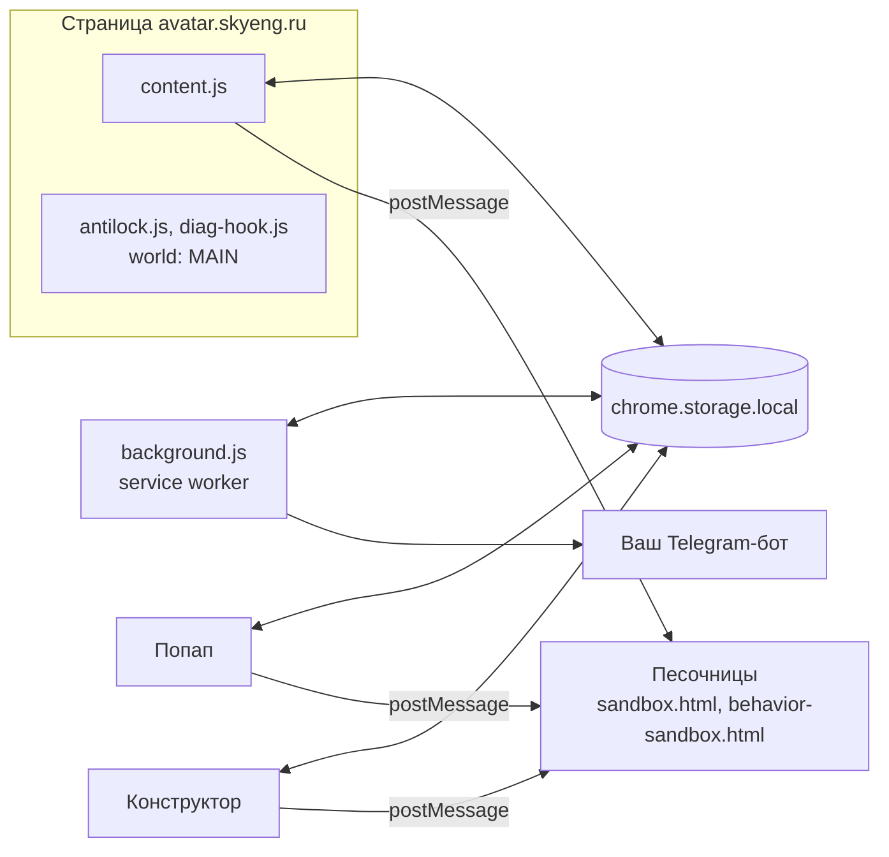

<div align="center">

# SkyMod

**Свой цвет, фон и расписание в личном кабинете Skyeng / Skypro:<br>тема, canvas-анимация и собственный код прямо на странице сайта.**

<br>

[](https://developer.chrome.com/docs/extensions/mv3/)
[](CHANGELOG.md)
[](LICENSE)
[](#-разработка)
[](#-разработка)
[](#-установка)

[](https://github.com/sploofer1/SkyMod)
[](https://github.com/sploofer1/SkyMod/commits/main)
[](https://github.com/sploofer1/SkyMod/stargazers)
[](https://github.com/sploofer1/SkyMod/network/members)
[](https://github.com/sploofer1/SkyMod/issues)

<br>

| | | | |
| :---: | :---: | :---: | :---: |
| [](#-установка) | [](https://github.com/sploofer1/SkyMod/issues/new?labels=bug) | [](https://github.com/sploofer1/SkyMod/issues/new?labels=enhancement) | [](CHANGELOG.md) |

<!-- TODO: кнопки для Chrome Web Store (расширения там нет), Telegram-канала и Wiki. Добавьте, когда появятся.
     TODO: если в репозитории появятся .github/ISSUE_TEMPLATE/bug_report.yml и feature_request.yml,
     замените ?labels=bug на ?template=bug_report.yml, а ?labels=enhancement на ?template=feature_request.yml -->

</div>

<br>

> [!NOTE]
> SkyMod — неофициальное расширение. Оно не связано со Skyeng, Skypro и Sky Group и не одобрено ими.

SkyMod превращает личный кабинет [avatar.skyeng.ru](https://avatar.skyeng.ru) в ваш: меняет цвета, шрифты, фон, карточки занятий и добавляет в расписание собственные блоки. Главная фишка в том, что сайт построен на CSS-переменных (`--ds-color-*`, `--ds-color2-color-*`), и расширение переопределяет несколько из них в одном теге `<style>`, а не красит сотни элементов по отдельности. Конструктор позволяет собрать тему, фон и поведение карточек без кода или с собственным HTML/CSS/JS в изолированных песочницах. Всё работает локально в вашем браузере.

<div align="center">

<!-- TODO: видео-демо. Раскомментируйте и подставьте ссылки (превью можно взять любое, сейчас стоит самый широкий скриншот):
[](ССЫЛКА_НА_ВИДЕО)
-->


</div>

<br>

| Без сборки | Всё локально | Полностью настраиваемо |
| :--- | :--- | :--- |
| Ванильный JS, ноль зависимостей. Работает прямо из папки. | Настройки в браузере, трекеры заблокированы, ничего не уходит на сторонние серверы. | От цвета карточки до собственного canvas-фона на весь экран. |

---

## ✨ Возможности

**Темы и цвета**

- **Фон страницы:** сплошной цвет, градиент, анимированный RGB-перелив, свой CSS или картинка/gif (ссылка или файл).
- **Шрифт:** готовые пресеты, ссылка на Google Fonts или свой файл. Библиотека хранит все загруженные шрифты сразу.
- **Карточки занятий:** цвет, прозрачность, читаемость на цветном фоне, свой цвет для каждого предмета (автоподбор или ручной выбор).

**Фоны сайта**

- Свой canvas/JS на весь экран avatar.skyeng.ru, работает, пока открыта вкладка.
- Свечение под текущий урок: фон подсвечивается цветом идущего занятия.

**Поведение карточек занятий**

- HTML-шаблон и JS-логика для карточек занятий и своих блоков.
- Окно занятия: размытие и затемнение фона, свой цвет панели.
- Полоска «сейчас»: тонкая настройка цвета и вида маркера текущего времени.

**Свои блоки в расписании**

- Своё событие на сетке (репетитор, секция, работа) с цветом, временем и повтором.

**Уведомления в Telegram**

- Напоминания через вашего собственного бота: свой токен, свой чат, без общего сервера.
- Отдельные переключатели для занятий, контрольных и своих блоков.

**Скрытие элементов интерфейса**

- Кнопка поддержки, аватарка, заголовок, меню, значок в шапке.

**Защита от блокировки**

- Сайт не перезагружает страницу при долгом отсутствии.

**Удобство**

- **Внешние ссылки** открываются в новой вкладке, сайт не закрывается.
- **Блокировка трекеров:** Google Analytics и Tag Manager отключаются через `declarativeNetRequest`.
- **Кнопка «Следующее задание»:** переход к следующей задаче без возврата к списку. Перетаскивается, помнит позицию, горячая клавиша `Alt+N`.
- **Диагностика:** журнал запросов, событий и слушателей страницы для разбора багов. Только локально.

**Попап**

- Три размера: компактный, крупный, максимальный (в пределах лимитов Chrome).
- Свои цвета отдельно для «Mod» в шапке, для пульсов и для остального интерфейса.
- Дорожки платы на canvas с анимированными импульсами.
- Экспорт и импорт всех настроек одним файлом, с выбором категорий при импорте.

---

## 📸 Скриншоты

<div align="center">


<br>
<em>Конструктор, режим «Сайт»: редактор кода, отладчик, консоль и живой предпросмотр.</em>

<br><br>


<br>
<em>Фон сайта: canvas-анимация на весь экран avatar.skyeng.ru.</em>

<br><br>

<table>
  <tr>
    <td align="center" width="50%">
      <br>
      <em>Попап, вкладка «Вид»: цвета, фон и шрифт.</em>
    </td>
    <td align="center" width="50%">
      <br>
      <em>Расписание со своими блоками: событие с цветом и временем.</em>
    </td>
  </tr>
</table>

</div>

---

## 🧩 Как это работает

Сайт построен на CSS-переменных (`--ds-color-*` и `--ds-color2-color-*`). Вместо того чтобы точечно красить сотни элементов, расширение переопределяет несколько переменных в одном теге `<style>`, а браузер сам применяет новый цвет везде, где они используются.



**Компоненты**

- **`content.js`** — главный content script: применяет тему, читает расписание, запускает фон сайта.
- **`background.js`** — service worker: блокировка трекеров, SPA-навигация, отправка напоминаний в Telegram.
- **`antilock.js`, `diag-hook.js`** — работают в контексте страницы (`world: MAIN`): защита от «страница заскучала» и диагностический хук.
- **Песочницы** `sandbox.html` и `behavior-sandbox.html` — изолированные страницы для вашего HTML/CSS/JS: фон, попап, поведение карточек.
- **Попап** — быстрые настройки; все данные хранятся в `chrome.storage.local`.
- **Конструктор** — отдельная страница с редактором, отладчиком, консолью и пресетами.
- **Telegram-бот** — ваш собственный: токен и чат хранятся локально, общего сервера нет.

**Детали реализации**

- **Цвета** применяются через `document.documentElement.style.setProperty(..., 'important')` — максимальный приоритет в CSS.
- **Фон страницы:** прямой `!important` на обёртки (`.page-scroll`, `.dashboard-shell`, `.topbar`): они красят себя хардкодом, а не через переменные.
- **Пользовательский код** выполняется в sandbox-страницах без доступа к `chrome.*` и DOM попапа. Связь только через `postMessage`.
- **Расписание:** расширение читает карточки занятий прямо со страницы, сохраняет их в `chrome.storage.local` и раз в 15 секунд пересчитывает, что идёт сейчас. Данные доступны и попапу, и коду фона.
- **Производительность:** для применения темы в `content.js` нет ни одного `setInterval` и ни одного `MutationObserver`. При загрузке страницы читаются настройки и собирается один тег `<style>`.

---

## 📦 Установка

Расширения нет в Chrome Web Store, поэтому оно ставится вручную. Есть два способа.

**Из релиза**

<!-- TODO: подтвердите, что в репозитории публикуются релизы с zip-архивом. Если нет, удалите этот способ. -->

1. Скачайте архив из [Releases](https://github.com/sploofer1/SkyMod/releases/latest) и распакуйте его.
2. Откройте `chrome://extensions/` и включите **Режим разработчика** в правом верхнем углу.
3. Нажмите **Загрузить распакованное** и выберите папку с `manifest.json`.

**Из исходников**

1. Склонируйте репозиторий:

```bash
   git clone https://github.com/sploofer1/SkyMod.git
```

2. Откройте `chrome://extensions/`.
3. Включите **Режим разработчика** в правом верхнем углу.
4. Нажмите **Загрузить распакованное** и выберите папку с `manifest.json`.
5. Откройте [avatar.skyeng.ru](https://avatar.skyeng.ru) и кликните на иконку расширения.

> [!TIP]
> После установки всё уже работает с разумными настройками по умолчанию: включены блокировка трекеров, защита от блокировки сайта и кнопка «Следующее задание». Остальное настраивается по желанию.

**Поддерживаемые браузеры:** Chrome 120+, Edge, Brave, Arc и любой другой Chromium-браузер с поддержкой Manifest V3.

---

## 🚀 Использование

1. Установите расширение и откройте [avatar.skyeng.ru](https://avatar.skyeng.ru).
2. Кликните на иконку SkyMod: откроется попап ([как он выглядит](docs/screenshots/popup-theme.png)).
3. Выберите раздел: «Вид», расписание, «Удобство», «Задания и Telegram».
4. Меняйте настройки: они применяются на лету, страницу перезагружать не нужно.

Для фона и поведения карточек откройте конструктор из попапа.

---

## 🛠 Конструктор

Конструктор — отдельная полноценная страница, а не тесный попап: редактор кода, отладчик, консоль, пресеты и живой предпросмотр. Без кода можно настроить темы и цвета, фон страницы, цвета предметов и вид карточек занятий, а также добавить в расписание свои блоки с цветом, временем и повтором.

Для тех, кому нужно больше, есть режимы со своим кодом. «Песочница попапа» запускает HTML/CSS/JS в окне расширения. «Фон сайта» рисует собственный canvas на весь экран. «Части интерфейса» принимают CSS для отдельных элементов сайта, и в комплекте идёт готовый промпт для ИИ: скопировали, вставили в чат, получили рабочий CSS. «Поведение карточек» даёт HTML-шаблон и JS-логику для карточек занятий и своих блоков. А «Глобальный CSS попапа» переопределяет любой стиль самого расширения.

---

## 🔒 Приватность

- Данные не отправляются на сторонние серверы. Единственное исключение — ваш собственный Telegram-бот, если вы подключите его для напоминаний.
- Все настройки хранятся локально в `chrome.storage.local`. Экспорт и импорт — только файлом, который вы сами сохраняете.
- Google Analytics и Tag Manager блокируются через `declarativeNetRequest`.
- Ваш код выполняется в sandbox-страницах без доступа к `chrome.*` и DOM попапа.
- Никаких внешних CDN, шрифтов и иконок в самом расширении. Запросы к внешним ресурсам идут только если вы сами указали ссылку: картинку фона или шрифт с Google Fonts.
- Диагностика работает только локально.
- Расширение не затрагивает оценки, дедлайны и содержимое курсов.

---

## 🧑‍💻 Разработка

Сборки нет совсем: правьте файлы прямо в папке расширения. Требования: Chromium 120+ с поддержкой Manifest V3.

<details>
<summary><b>Структура проекта</b></summary>

<br>

```text
SkyMod/
├── manifest.json            Манифест MV3
├── background.js            Service worker: трекеры, SPA-навигация, Telegram
├── content.js               Главный content script: тема, расписание, фон сайта
├── schedule-core.js         Общая логика расписания (используется в трёх местах)
├── part-runtime.js          Общие утилиты для частей интерфейса
├── antilock.js              Защита от «страница заскучала» (world: MAIN)
├── diag-hook.js             Диагностический хук (world: MAIN)
│
├── rules/
│   └── trackers.json        Правила declarativeNetRequest
│
├── math/                    Модуль «Следующее задание»
│   ├── list-page.js
│   ├── task-page.js
│   └── style.css
│
├── popup/
│   ├── popup.html/.js/.css          Основной попап
│   ├── popup-size-early.js          Ставит размер попапа до первой отрисовки
│   ├── builder.html/.js/.css        Страница конструктора
│   ├── builder-tour.js              Обучающий тур по конструктору
│   ├── parts.js                     Реестр частей интерфейса и генераторы промптов
│   ├── part-preview.js              Живой предпросмотр частей
│   ├── docs.html/.js                Документация конструктора
│   ├── backup.html/.js              Страница бэкапа настроек
│   ├── settings-io.js               Общий экспорт и импорт
│   ├── sandbox.html/.js             Песочница пользовательского кода
│   └── behavior-sandbox.html/.js    Песочница поведения карточек
│
└── docs/screenshots/        Скриншоты для README
```

</details>

**Как применять изменения и отлаживать**

| Что делаем | Как |
| :--- | :--- |
| Применить изменения | На `chrome://extensions/` нажмите **Обновить** на карточке SkyMod, затем обновите вкладку сайта (`F5`). Service worker перезапускается сам |
| Отладить content script | `F12` на странице сайта, **Sources**, **Content scripts**, SkyMod |
| Отладить попап | Правый клик на иконке, **Просмотреть код попапа** |
| Отладить конструктор | `F12` на открытой странице `builder.html` |

**Где править CSS-переменные.** Переопределение `--ds-color-*` и `--ds-color2-color-*` происходит в `content.js`, где собирается тег `<style>` с темой. Обёртки, которые красятся хардкодом (`.page-scroll`, `.dashboard-shell`, `.topbar`), получают прямой `!important`.

**Стиль кода**

- ES2020 без транспиляции, никаких бандлеров и внешних зависимостей.
- `const` / `let`, `async` / `await`, шаблонные строки там, где уместно.
- Комментарии на русском, по делу.

---

## ❓ FAQ

<details>
<summary><b>Не сломает ли это античит или проверки сайта?</b></summary>

<br>

Расширение не затрагивает оценки, дедлайны и содержимое курсов, а только меняет внешний вид и добавляет удобства. Гарантий дать нельзя: SkyMod неофициальный, а сайт может обновиться. Если что-то пошло не так, отключите расширение и напишите issue с диагностическим снимком.

</details>

<details>
<summary><b>Почему тема не применилась на некоторых страницах?</b></summary>

<br>

Чаще всего сайт обновил разметку. Так было с обновлением от 08.10.2026: у карточки появилась новая разметка и маркер `.now-marker`. Сначала нажмите **Обновить** на карточке SkyMod в `chrome://extensions/` и перезагрузите вкладку (`F5`). Если не помогло, заведите issue и приложите диагностический снимок: Попап, Удобство, Диагностика, Скачать снимок.

</details>

<details>
<summary><b>Как откатить изменения?</b></summary>

<br>

Отключите или удалите расширение, и сайт вернётся к исходному виду. Если хотите сохранить настройки, заранее сделайте экспорт одним файлом в попапе. При импорте можно выбрать категории, которые нужно восстановить.

<!-- TODO: если в попапе есть кнопка «Сбросить настройки», упомяните её здесь. -->

</details>

<details>
<summary><b>Куда приходят уведомления?</b></summary>

<br>

В ваш чат Telegram через вашего собственного бота: токен и чат вы указываете сами. Общего сервера нет, токен хранится локально и никому не передаётся. Для занятий, контрольных и своих блоков есть отдельные переключатели.

</details>

<details>
<summary><b>Можно ли использовать свой код для фона?</b></summary>

<br>

Да, в конструкторе, режим «Фон сайта». Код запускается в sandbox-странице без доступа к `chrome.*` и DOM попапа и общается с расширением только через `postMessage`.

</details>

<details>
<summary><b>Работает ли в Edge, Brave, Arc?</b></summary>

<br>

Да, в любом Chromium-браузере с поддержкой Manifest V3 (Chrome 120+).

</details>

---

## 🗺 Roadmap

Полный список в [TODO.md](TODO.md), история изменений в [CHANGELOG.md](CHANGELOG.md). Коротко:

| Приоритет | Задача |
| :---: | :--- |
| **P0** | Глобальный рефакторинг конструктора: пресеты, предпросмотр попапа, общий UX, мелкие баги |
| **P0** | Прогресс при загрузке файлов |
| **P1** | Фон сайта получает координаты карточек: свечение и следы по краям карточки при наведении |
| **P1** | Кросс-песочное взаимодействие через `api.bus`: события между фоном и поведением карточек |
| **P1** | Больше частей интерфейса в реестре и мелкие улучшения диагностики и экспорта |
| **P2** | Экспорт и импорт тем, галерея готовых тем, режим «Фокус», кастомные звуки |

<details>
<summary><b>Недавно сделано</b></summary>

<br>

- **2.19.3** — единое правило «часть владеет настройками», замки в попапе обновляются сразу.
- **2.19.2** — исправлена часть «Карточка занятия»: настройки попапа больше не перебивают CSS части.
- **2.19.1** — адаптация под обновление сайта от 08.10.2026: новая разметка карточки, маркер `.now-marker`.
- **2.18.0** — живой предпросмотр частей интерфейса в конструкторе.
- **2.17.0** — поведение карточек: свои HTML и JS.

</details>

---

## 🤝 Вклад

Issues и pull request'ы приветствуются.

- **Баг.** Заведите issue с шагами воспроизведения и, если возможно, приложите диагностический снимок: Попап, Удобство, Диагностика, Скачать снимок.
- **Идея.** Опишите сценарий: «сейчас делаю X, хочу Y, потому что Z». Без сценария сложно оценить пользу.
- **Pull request.** Сначала обсудите в issue. Небольшие точечные правки принимаются быстрее крупных рефакторингов.

> [!WARNING]
> Нельзя добавлять внешние зависимости и сборку, подключать сторонние CDN, шрифты и иконки сверх уже используемых, отправлять пользовательские данные на сторонние серверы, а также ломать существующие ключи в `chrome.storage.local` (только миграция).

---

## 📄 Лицензия

[MIT](LICENSE). Делайте что хотите, только сохраните копирайт.

## 👤 Автор

**sploofer1** — [github.com/sploofer1](https://github.com/sploofer1)

## ⚠️ Отказ от ответственности

SkyMod не связан со Skyeng, Skypro и Sky Group, не одобрен и не поддерживается ими.

Расширение не затрагивает оценки, дедлайны и содержимое курсов. Все настройки хранятся локально в вашем браузере. Если вы подключаете Telegram-уведомления, они идут через вашего собственного бота, а токен хранится локально и никому не передаётся.

Если сайт обновится и что-то сломается, напишите issue и приложите диагностический снимок.

<br>

<div align="center">

**Сделано для тех, кто каждый день открывает Skyeng.**

Если зашло, поставьте звезду репозиторию.

</div>
